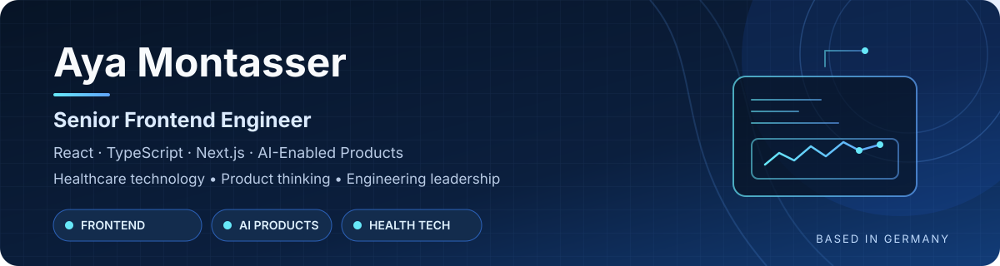

<!-- Profile README for github.com/ayamontasser-2404 -->

  

# Aya Marzouk

### Senior Frontend Engineer · React & TypeScript · AI-Enabled Products

I build thoughtful, maintainable digital products at the intersection of **frontend engineering, product thinking, and AI**.

Based in Germany · Authorized to work in Germany

<a href="https://www.linkedin.com/in/aya-marzouk-72634237/">LinkedIn</a> · <a href="https://github.com/ayamontasser-2404">GitHub</a>

---

## About Me

I'm a software engineer with **15 years of experience** building software, including work in healthcare technology and cross-functional product delivery. I enjoy translating complex workflows into clear user experiences, shaping frontend architecture, and collaborating with design, product, backend, and QA teams.

My current focus is hands-on engineering: building with React and TypeScript, improving code quality and testing, and exploring practical ways to integrate AI into useful products.

## Featured Projects

### 🩺 [CareDocs AI](https://github.com/ayamontasser-2404/caredocs-ai)
**AI-assisted healthcare document review · In progress**

A project exploring how document processing and AI-assisted workflows can help reviewers identify, structure, validate, and compare information in healthcare documents.

- PDF text extraction with an OCR fallback
- Structured extraction and validation workflows
- Document comparison and discrepancy review
- Human verification as part of the workflow

### 🔎 [Doctor Search](https://github.com/ayamontasser-2404/doctor-search)
**Provider discovery · React + TypeScript**

A frontend application for exploring doctor and provider-search experiences.

- Search and filter providers by relevant criteria
- Provider profile routes and not-found handling
- Reusable UI components and typed application structure
- Automated tests with Vitest and Testing Library

### 💬 [ChatWeb](https://github.com/ayamontasser-2404/ChatWeb)
**Conversational UI · React + TypeScript**

A chatbot interface project focused on building practical frontend skills through a familiar, conversation-based experience.

- Component-based interface structure
- Conversation and message UI
- Interactive input and message flows

## Technical Toolkit

**Engineering:** React architecture · TypeScript · Next.js · API integration · Automated testing · Responsive UI

**Product collaboration:** Design systems · UX-focused implementation · Technical planning · Cross-functional delivery

**AI product development:** LLM-powered interfaces · Document workflows · Human-in-the-loop review

## How I Work

- **User-first engineering:** Start with the problem and make complex workflows easier to use.
- **Maintainable by design:** Prefer clear component boundaries, typed data, and testable logic.
- **End-to-end ownership:** Connect product requirements to implementation, integration, and quality.
- **Practical AI:** Focus on AI features that support real workflows, with validation and human oversight where needed.

## Current Focus

- Building portfolio projects that demonstrate production-minded React and TypeScript skills
- Improving testing, architecture, and frontend implementation practices
- Exploring AI-assisted document workflows and reliable product experiences

## Let's Connect

I'm interested in opportunities in **Senior Frontend Engineering, AI-enabled product development, and frontend-focused product engineering**.

**[Connect on LinkedIn](https://www.linkedin.com/in/aya-marzouk-72634237/)** · **[Explore my repositories](https://github.com/ayamontasser-2404?tab=repositories)**
